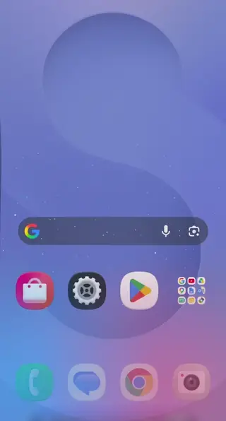
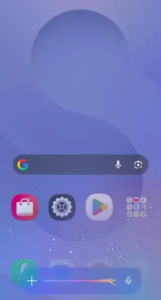
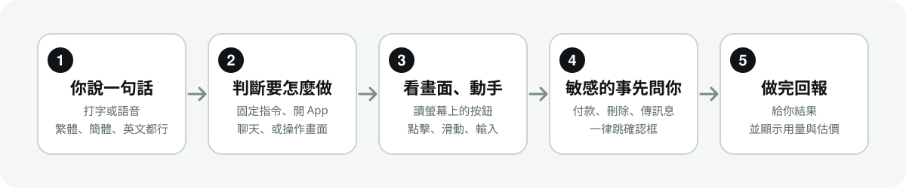
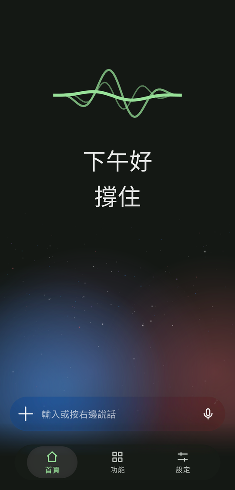
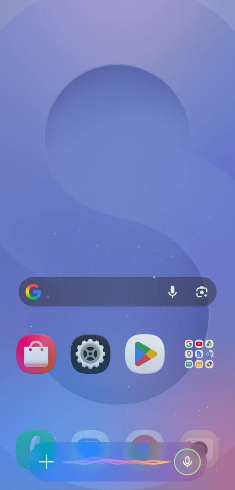
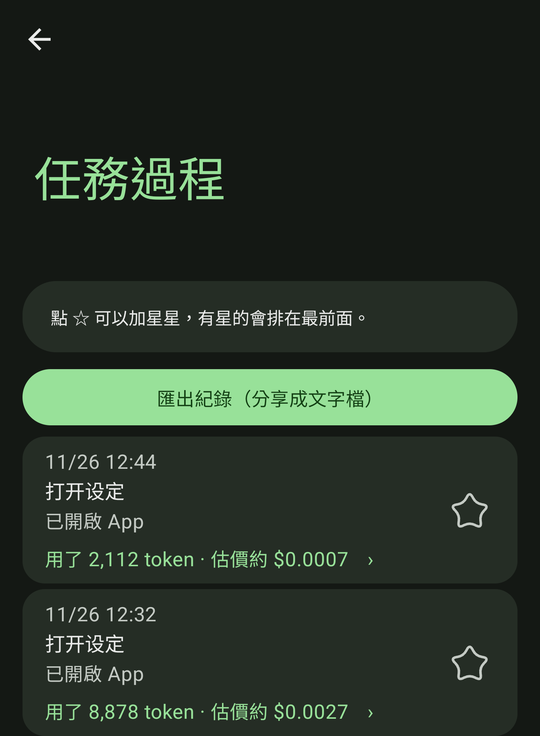

# Vertex (formerly PhoneAI Overlay)

English | [繁體中文](README.md)

<p align="center"></p>

<p align="center">
<a href="../../releases/latest"></a>

<a href="LICENSE"></a>
</p>

**This is not a voice assistant that answers questions. It's an AI that actually operates your phone for you.**

You say one sentence, and it opens apps, looks at the screen, taps, swipes and types by itself, then reports back. It isn't limited to certain apps; it works even with apps that have no public interface.

**You need:** Android 13 or later, a key for an AI service (the app has setup instructions), and the accessibility service. **Measured:** a fixed command like "open Settings" takes about 1 second and costs under $0.001; every task ends with a report of tokens used and an estimated cost.

> "Search for earphones in Shopee." "Turn on Bluetooth." "Message Xiao Ming on Instagram that I'll be late." "What's on my schedule tomorrow?" "Remember the timetable in that photo."

<table align="center">
<tr>
<td align="center" width="50%"><br><sub>1. Call the panel and say one sentence</sub></td>
<td align="center" width="50%"><br><sub>2. It opens Shopee, types and searches by itself</sub></td>
</tr>
</table>
<p align="center"><sub>Real recording. About 8 seconds in the middle, where the AI is thinking and nothing moves on screen, are cut.</sub></p>

<p align="center"></p>

<table align="center">
<tr>
<td align="center" width="33%"><br><sub>Home: type or tap the mic</sub></td>
<td align="center" width="33%"><br><sub>Call the assistant panel over any screen</sub></td>
<td align="center" width="33%"><br><sub>Task history: usage and cost every time</sub></td>
</tr>
</table>

## How it differs from an ordinary voice assistant

| | Ordinary voice assistant | Vertex |
|---|---|---|
| What it can do | Only the few functions the vendor exposes | Operates **any app** by looking at the screen, including apps with no public interface |
| How it works | Calls interfaces apps provide | Looks at the screen, taps, swipes and types like a person |
| Gets smoother with use | No | Steps that worked are saved as **macros** and replayed next time; mistakes become remembered lessons |
| Your phone while it works | Tied up | Can work on a **background virtual screen** while you keep using the phone (needs root) |
| Passwords, codes, unlock | Usually just fails | **Pauses and asks you to take over**, then continues when you press "Continue" |
| Sensitive actions | Up to the vendor | Payments, transfers, deleting, installing, sending messages, logging in… **always ask first**; no answer counts as "no" |
| Which AI, what it costs | Locked to the vendor | Your choice: Claude, Gemini (free tier), DeepSeek, OpenAI, or a local model; a cheap model goes first and escalates only when stuck; every task shows usage and a cost estimate, with daily/monthly limits |
| Your data | Passes through the vendor's servers | No Vertex server: your key stays on the phone and talks directly to the AI service you chose; speech recognition runs offline on the phone |
| Root needed? | n/a | Root is the most complete; Shizuku or accessibility-only normal mode also work |
| Source code | Closed | Open source (Apache 2.0) |

## And also

- **Outside services (MCP)**: connect GitHub, Notion and others by sign-in or token so the AI can look up your data; actions that change data always ask first.
- **Your schedule and notifications**: ask "What's on tomorrow?" or have it summarize today's notifications.
- **Scheduled tasks**: "Tell me the battery every morning at 8"; it can also operate the phone on a schedule (it waits for you to unlock a locked phone).
- **File transfer between your phones**: encrypted after pairing, and it can also go across different networks through Tailscale.
- **Circle to ask**: freeze the screen, circle what you want to ask about, and the AI answers from the image.
- **Traditional Chinese, Simplified Chinese and English UI**, with adjustable theme color and a liquid-glass bottom bar.

## Honestly: when it's not for you

- **It's still an experiment**: most features were verified only on the author's Samsung Galaxy S25+ (Android 16); other phones may misbehave.
- **The AI sees your screen**: during automation, screenshots or on-screen text are sent to the AI service you chose. Don't use it on banking, private messages or screens with personal data (background mode refuses banking and payment apps).
- **It won't always get it right**: complex tasks can get stuck or go the wrong way, which is why sensitive steps always ask first and you can press Stop at any time.
- **Android only**, no iOS version.

## Get started in 3 steps

1. Download the latest `PhoneAI.apk` from **[Releases](../../releases)** and install it (later updates are one tap inside the app).
2. Open the app, follow the guide to grant permissions, and choose an AI service and enter its key (the app has step-by-step instructions).
3. Say "open the Wi-Fi page in Settings" in the input box.

> This is a personal experiment. Many features have only been verified on the author's phone (Samsung Galaxy S25+, Android 16), so it may not work on every device. It uses root, Shizuku or accessibility permissions to operate the screen; please read [Safety and privacy](#safety-and-privacy) first.
> To continue development, read [`CLAUDE.md`](CLAUDE.md) and [`HANDOFF.md`](HANDOFF.md) first (both are in Chinese).

---

# Details

The whole project is one app: **no PC, no Termux, no Python scripts**.

## What it can do

| Feature | Description |
|---|---|
| Assistant panel | Type or speak. Open it from the app's home screen, a quick-settings tile, a long press of the power button (set it as the default digital assistant), a floating button on the screen edge, a home-screen widget or "Share to assistant" |
| Fixed commands (instant) | Turn Wi-Fi / Bluetooth on or off, go back, set the volume (you can say a percentage), launch any app by name |
| Chat and tools | Ask questions directly. The chat assistant can use memory (to-dos, notes), alarms, the calendar (add and read events), **Samsung Reminder**, maps, dialing, file transfer and read-only system commands (battery, storage, which apps are installed…) |
| Screen automation | The AI looks at the screen (accessibility element list, or a screenshot when needed) and taps, swipes, drags and types step by step to finish what you asked (20 steps by default, adjustable from 8 to 40 in Settings; a cheap model goes first and a stronger one takes over when stuck) |
| Remembered routes | A clean run is saved as a **macro** and replayed next time; after a wrong turn the AI writes itself a **lesson** that is added to later prompts |
| Background mode | Operates on a virtual screen in the background so you can keep using the phone, with preview and takeover (needs root) |
| When only you can do it | For an unlock pattern, password or code the AI pauses and shows a draggable card asking you to take over; press Continue when done |
| Switch AI service to save money | Claude by default; you can also choose Gemini (free tier), DeepSeek, OpenAI or any OpenAI-compatible service, with separate cheap and vision slots, an A/B comparison page and per-service cost estimates |
| Web search | Only when you say "look up…": paste a Tavily key and any AI can use it; with Claude there is also a built-in search (used only when current information is needed, limited per task) |
| File transfer | Pair your own phones (and the Windows app in `windows-transfer/`) and send files; off by default |
| Circle to ask | The ◎ in the assistant panel freezes the screen; circle something with your finger and the AI answers about it, with follow-ups |
| Outside services (MCP) | Settings → AI & data: connect GitHub (read-only), Notion and other MCP services, with OAuth sign-in; tools that change data always ask first |
| Memory and schedules | To-dos and notes, and scheduled simple queries such as "tell me the battery every morning at 8" |
| Voice recognition | Offline SenseVoice model (downloaded inside the app); the text is sent after a short countdown so you can edit it |
| While it runs | A ripple at every tap, Stop and Pause buttons in the notification, and a Now Bar capsule on Samsung phones (optional) |
| Logs and diagnostics | The task history page lists every step's thinking, action, result and cost estimate, and exports to a text file (no API keys); plus self-check and diagnostics pages |
| Interface | A liquid-glass bottom bar; theme colour and Traditional Chinese / English interface can be changed in Settings |

## Three execution modes

| Mode | Needs | Difference |
|---|---|---|
| root | A rooted phone | The most complete and fastest; background mode and all fixed commands work |
| Shizuku | Shizuku installed and started (no root) | `input`, `settings put`, `screencap` and similar run with adb-level permission; features that need real root (background screen) are not supported |
| Normal | Only the accessibility service | Taps and screenshots use accessibility; Wi-Fi, Bluetooth and similar can only open the settings page for you to switch |

Pick a mode in the first-run guide; change it later under "Settings → While running tasks → Execution mode". A full comparison is in [`docs/NO_ROOT.md`](docs/NO_ROOT.md) (Chinese).

## Requirements

- Android 13 or later (the author tests on Android 16)
- An API key for one AI service: [Anthropic](https://console.anthropic.com/) (default) or another service such as Gemini (the app has a step-by-step guide for getting a key). The key is stored only in the app's private folder on the phone, never in the repo
- Accessibility service and overlay permissions (the in-app "Setup guide" walks you through them)

## Install

1. Download the latest `PhoneAI.apk` from this repo's **Releases** page and install it. The APK is signed with a fixed key, so later versions install over the old one; "Features → Maintenance → Check for updates" in the app can also update it and shows what changed.
2. Open the app and follow the guide: choose an execution mode, then overlay, accessibility service and notification permissions (plus root access if you use root).
3. Choose a service and enter your key under "Features → AI service and API key" (a service you already entered a key for is not asked again).
4. Try typing "turn on Bluetooth" or "open the Wi-Fi page in Settings" in the home screen input box.

## Safety and privacy

- It taps the screen with root, Shizuku or accessibility permission. File transfer is off by default; when turned on it listens on the local network, and only paired devices can connect, content is encrypted, only `/sdcard` is exposed and every file taken triggers a notification.
- **Sensitive actions always show a confirmation dialog** (payment, transfer, deletion, installation, sending messages, login, passwords); no response counts as "no".
- During screen automation, **a screenshot or the on-screen text is sent to the AI service you chose at every step**. Do not use it on banking, private messaging or other personal screens (background mode refuses to operate protected apps such as banking and payment).
- Never paste your API key into a chat or commit it to git. Screenshots, logs and model files are excluded by `.gitignore`.

## FAQ

- **It doesn't react when asked?** Check that every page of "Settings → Other → Setup guide" has a tick. Most often the **accessibility service was turned off by the system** (after a reinstall or system update). With root, "Features → Advanced & diagnostics → Repair permissions" restores it.
- **Scheduled tasks or file transfer unreliable?** Many phones kill background apps. Go to "Settings → Permissions → Keep-alive check", set battery to "Unrestricted" and turn on auto-start.
- **Is it expensive?** Every task ends with tokens and an estimated cost (your AI service's dashboard is authoritative). Set daily and monthly limits in "Settings → Usage and limits"; a cheap model goes first and escalates only when stuck.
- **Want to know what it just did?** "Features → Task history" lists every step's reasoning, action and result, and can be exported as a text file (without your API key).
- **What changed in each update?** See [`CHANGELOG.md`](CHANGELOG.md); the app also shows it after updating.

## Build it yourself

```bash
cd android-overlay
gradle testDebugUnitTest assembleDebug   # needs Android SDK 36 and Gradle 8.14 or newer
```

Release APKs are built by GitHub Actions (`.github/workflows/android.yml`) and published to Releases.

## Project layout

```
CLAUDE.md          Notes for Claude Code (read this first, Chinese)
HANDOFF.md         Full handoff: goals, status table, decisions, next steps (Chinese)
android-overlay/   App source (Java, Gradle)
.github/workflows/ Cloud APK build
windows-transfer/  Windows app for file transfer (Python)
docs/              Notes (AppFunctions, the three modes, file transfer design…); docs/archive/ holds Termux-era history and finished roadmaps
```

## Credits

- Offline speech recognition: [sherpa-onnx](https://github.com/k2-fsa/sherpa-onnx) and SenseVoice.
- The glass effect's design was informed by the KernelSU manager's FloatingBottomBar / Lens and Kyant's AndroidLiquidGlass (design only; none of their code was copied).

## License

Apache License 2.0, see [`LICENSE`](LICENSE).
