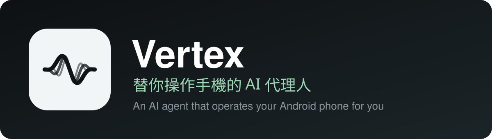
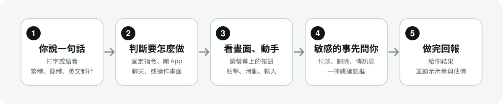

# Vertex（原名 PhoneAI Overlay）

[English](README.en.md) | 繁體中文

<p align="center"></p>

**它不是回答問題的語音助理，而是真的替你操作手機的 AI。**

你說一句話，它自己開 App、看著螢幕點擊、滑動、輸入，做完回報。不限定哪個 App，連沒有開放介面的 App 也行。

> 「去蝦皮搜尋耳機」「幫我開藍牙」「用 Instagram 傳訊息給小明說我晚點到」「明天有什麼行程？」「把相簿裡那張課表記起來」

<p align="center"></p>

## 跟一般語音助理差在哪

| | 一般語音助理 | Vertex |
|---|---|---|
| 能做的事 | 只能做廠商開放的少數功能 | 看著畫面操作**任何 App**，包括沒有開放介面的 |
| 做事的方式 | 呼叫 App 提供的介面 | 像人一樣看螢幕、點擊、滑動、輸入 |
| 會不會越用越順 | 不會 | 走通的步驟存成**巨集**，下次同樣的事直接重播；走錯路會記下經驗 |
| 它在做事時你的手機 | 被佔住 | 可在**背景虛擬螢幕**操作，你照常用手機（需要 root） |
| 遇到密碼、驗證碼、解鎖 | 通常直接失敗 | **暫停並請你接手**，做完按「繼續」 |
| 敏感操作 | 看廠商 | 付款、轉帳、刪除、安裝、傳訊息、登入…**一律先跳確認框**，沒回應就當作不同意 |
| 用哪個 AI、花多少錢 | 綁定廠商 | 自己選：Claude、Gemini（有免費額度）、DeepSeek、OpenAI、或本機模型；便宜模型先做、卡住才升級；每次顯示用量與估價，可設每日／每月上限 |
| 你的資料 | 經過廠商的伺服器 | 沒有 Vertex 的伺服器：Key 只存在手機，直接連你選的 AI 服務；語音在手機上離線辨識 |
| 要不要 root | 不適用 | 有 root 最完整；也能用 Shizuku 或只靠無障礙服務的普通模式 |
| 原始碼 | 封閉 | 開源（Apache 2.0） |

## 還有這些

- **接外部服務（MCP）**：用登入或權杖接上 GitHub、Notion 等，AI 就能查你的資料；會修改資料的操作每次都先問你。
- **看你的行程與通知**：問「明天有什麼行程」，或請它整理今天的通知。
- **定時任務**：「每天早上 8 點告訴我電量」；也可以定時讓它操作手機（手機鎖著時會等你解鎖）。
- **手機之間互傳檔案**：配對後加密傳輸，也支援透過 Tailscale 在不同網路之間傳。
- **圈選提問**：凍結畫面，圈出想問的地方，AI 看圖回答。
- **繁體、簡體、英文介面**，主題色與液態玻璃底欄可以自己調。

## 三步開始

1. 到 **[Releases](../../releases)** 下載最新的 `PhoneAI.apk` 並安裝（之後可在 App 內一鍵更新）。
2. 打開 App，跟著引導頁開啟權限，選一個 AI 服務並輸入 Key（App 內有申請教學）。
3. 在輸入框說「進入設定裡的 Wi-Fi 頁面」試試看。

> 這是個人實驗專案，很多功能只在作者的手機（Samsung Galaxy S25+、Android 16）上驗證過，不保證每台機型都能用。它會用 root、Shizuku 或無障礙權限操作螢幕，請先看[安全與隱私](#安全與隱私)。
> 要繼續開發請先讀 [`CLAUDE.md`](CLAUDE.md) 與 [`HANDOFF.md`](HANDOFF.md)。

---

# 詳細說明

整個專案就是一個 App，**不需要電腦、不需要 Termux、不需要 Python**。

## 它能做什麼

| 功能 | 說明 |
|---|---|
| 助理面板 | 打字或語音輸入。可從 App 主畫面、快速設定磁貼、長按電源鍵（設為預設數位助理）、螢幕邊緣的浮動按鈕、桌面小工具或「分享到助理」叫出 |
| 固定指令（瞬間） | 開關 Wi-Fi／藍牙、返回、音量（可直接說百分比）、用名稱開任何 App |
| 聊天與工具 | 直接問問題；聊天助理能用記憶（待辦、筆記）、鬧鐘、行事曆（新增、查詢行程）、**三星提醒**、地圖、撥號、互傳檔案、唯讀系統指令（查電量、儲存空間、裝了哪些 App…） |
| 自動操作畫面 | AI 看著畫面（無障礙元件清單，必要時截圖）一步一步點擊、滑動、拖曳、輸入，完成你交代的事（預設最多 20 步，可在設定調 8～40 步；便宜模型先做，卡住升級到更強的模型） |
| 記住做法 | 乾淨走完的步驟會記成**巨集**，下次同樣的任務直接重播；AI 走錯路後會自己記**經驗**，下次帶進提示 |
| 背景操作 | 在背景的虛擬螢幕操作，不影響你同時使用手機，可預覽與接手（需要 root） |
| 要你親自處理時 | 解鎖圖形、密碼、驗證碼這類只有你能做的事，AI 會暫停並跳出可拖動的卡片請你接手，做完按「繼續」 |
| 換 AI 服務省錢 | 預設用 Claude；也可選 Gemini（有免費額度）、DeepSeek、OpenAI 或任何 OpenAI 相容的服務，便宜模型與看圖模型可以分開設；有「AI 比較測試」與各服務的用量估價 |
| 聯網搜尋 | 你說「幫我查…」時才搜尋：可以貼 Tavily Key，任何 AI 都能用；用 Claude 時也有內建搜尋（需要即時資訊才用，有次數上限） |
| 互傳檔案 | 在自己的手機之間（以及 Windows 版，見 `windows-transfer/`）配對後傳檔案；預設關閉 |
| 圈選提問 | 助理面板的 ◎：畫面凍結後用手指圈出想問的地方，AI 看圖回答，可以追問 |
| 外部服務（MCP） | 設定 → AI 與資料：接上 GitHub（唯讀）或 Notion 等提供 MCP 的服務，可用 OAuth 登入；會修改資料的工具每次都先問你 |
| 記憶與定時 | 待辦與筆記、「每天早上 8 點告訴我電量」這類只做簡單查詢的定時任務 |
| 語音辨識 | 離線的 SenseVoice 模型（在 App 內下載），辨識完倒數幾秒才送出，期間可修改 |
| 執行時的提示 | 每次點擊處有漣漪、通知上有「停止」「暫停」鈕；三星手機會出現 Now Bar 膠囊（選用） |
| 紀錄與診斷 | 任務過程頁列出每一步的思考、動作、結果與估價，可匯出成文字檔（不含 API Key）；有自我檢查與診斷頁 |
| 介面 | 液態玻璃底欄，主題色與繁體中文／英文介面可在設定調整 |

## 三種執行模式

| 模式 | 需要 | 差別 |
|---|---|---|
| root | 已 root 的手機 | 最完整、最快；背景操作、固定指令全部可用 |
| Shizuku | 安裝並啟動 Shizuku（不用 root） | `input`、`settings put`、`screencap` 等走 adb 等級權限；背景螢幕等需要真正 root 的功能不支援 |
| 普通 | 只需要無障礙服務 | 點擊與截圖靠無障礙；Wi-Fi、藍牙等只能打開設定頁讓你自己切換 |

首次開啟的引導頁可以選模式，之後在「設定 → 執行任務時 → 執行模式」改。完整對照見 [`docs/NO_ROOT.md`](docs/NO_ROOT.md)。

## 需求

- Android 13 以上（作者在 Android 16 上測試）
- 一組 AI 服務的 API Key：[Anthropic](https://console.anthropic.com/)（預設），或 Gemini 等其他服務（App 內有一步一步的申請教學）。Key 只存在手機上 App 的私有資料夾，不進 repo
- 無障礙服務與懸浮視窗權限（App 內的「設定導覽」會一步一步帶你檢查）

## 安裝

1. 到本 repo 的 **Releases** 下載最新的 `PhoneAI.apk` 並安裝（APK 使用固定金鑰簽名，之後可直接覆蓋安裝；App 內「設定 → 更新 → 檢查並更新」也能一鍵更新，並會顯示這版改了什麼）。
2. 打開 App，跟著引導頁選執行模式，完成懸浮視窗、無障礙服務、通知權限（有 root 還要 root 授權）。
3. 到「功能 → AI 服務與 API Key」選服務並輸入 Key（已經輸入過的服務不會再問）。
4. 在首頁輸入框送出「開藍牙」或「進入設定裡的 Wi-Fi 頁面」試試看。

## 安全與隱私

- 會用 root、Shizuku 或無障礙權限點擊螢幕。「互傳檔案」預設關閉，打開後才會在區域網路上開放，只有配對過的裝置能連、內容加密、只開放 `/sdcard`、每次取走都發通知。
- 付款、轉帳、刪除、安裝、傳訊息、登入、密碼等**敏感操作一律跳確認框**，沒回應就視為不同意。
- 自動操作每一步會把**截圖或畫面文字傳到你選的 AI 服務**；不要在銀行、私訊或含個資的畫面使用（背景模式會拒絕操作銀行、支付這類受保護的 App）。
- API Key 絕對不要貼到聊天或提交進 git。截圖、紀錄檔、模型檔都已在 `.gitignore` 排除。

## 自己編譯

```bash
cd android-overlay
gradle testDebugUnitTest assembleDebug   # 需要 Android SDK 36 與 Gradle 8.14 以上
```

正式 APK 由 GitHub Actions（`.github/workflows/android.yml`）編譯並發布到 Releases。

## 專案結構

```
CLAUDE.md          給 Claude Code 的專案說明（先讀這個）
HANDOFF.md         完整交接：目標、狀態表、決策、下一步
android-overlay/   App 原始碼（Java、Gradle）
.github/workflows/ 雲端編譯 APK
windows-transfer/  互傳檔案的 Windows 版（Python）
docs/              說明文件（AppFunctions、三種模式、互傳檔案設計…）；docs/archive/ 是 Termux 時期與已完成路線圖的歷史紀錄
```

## 致謝

- 離線語音辨識：[sherpa-onnx](https://github.com/k2-fsa/sherpa-onnx) 與 SenseVoice。
- 底欄玻璃效果的設計參考了 KernelSU 管理器的 FloatingBottomBar／Lens 與 Kyant 的 AndroidLiquidGlass（只參考設計，沒有複製它們的程式碼）。

## 授權

Apache License 2.0，見 [`LICENSE`](LICENSE)。
